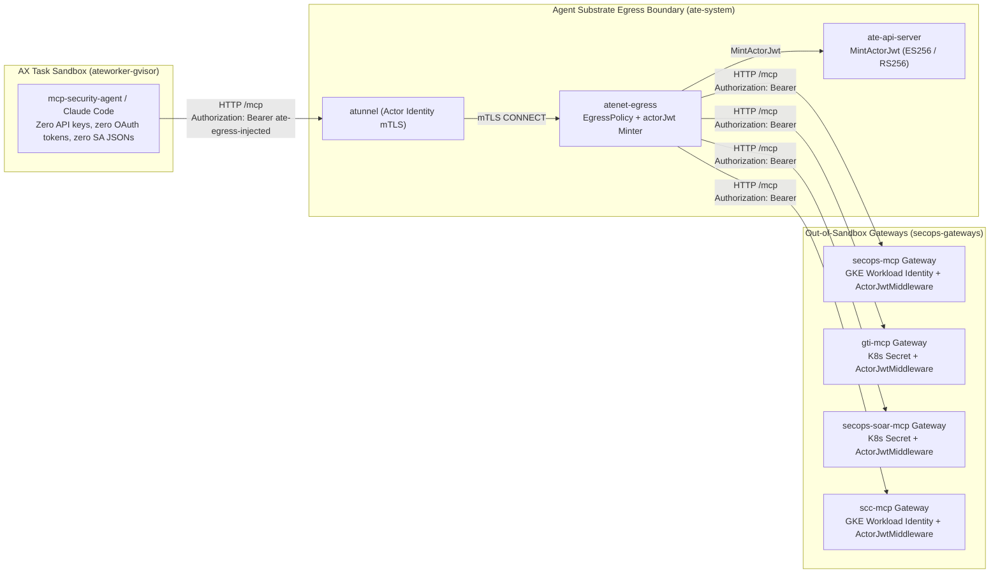

# Out-of-Sandbox Streamable HTTP MCP Gateway for AX and Agent Substrate

This directory deploys all four [`google/mcp-security`](../../README.md) servers (`secops`, `gti`, `secops-soar`, and `scc`) as **out-of-sandbox Streamable HTTP MCP gateways** in Kubernetes so autonomous security agents running on [AX](https://github.com/google/ax) (`ax.io/v1alpha1`) and [Agent Substrate](https://github.com/agent-substrate/substrate) (`ate.dev`) execute MCP tools with **zero cloud or API credentials inside the sandbox**.

## Architecture



### Security Properties

1. **Zero Credentials in the Sandbox**: The AX `Task` runs with `AX_ZERO_SECRET_SANDBOX=true` and `MCP_GATEWAY_AUTH_HEADER="Bearer ate-egress-injected"`. Startup calls `verify_zero_secret_sandbox()` across both `os.environ` and `/proc/self/environ` and fails closed if any cloud credential path, OAuth access token, or vendor API key leaked into the container.
2. **No MITM Trust Bundle Required for MCP Traffic**: Because the agent invokes the MCP gateways over cluster-internal HTTP (`Workspace.spec.mcp.servers[].endpoint`), `atenet-egress` applies `http` `replaceHeaders` rules directly without requiring TLS interception or mounting a custom CA bundle inside the AX `ActorTemplate`.
3. **Cryptographic `actorJwt` Caller Verification**: `atenet-egress` discards the sandbox's placeholder `Authorization` header and injects a short-lived `actorJwt` minted by `ate-api-server` (`sub: actor/<atespace>/<task>`, claim `actor.ate.dev`, scoped `aud` per MCP gateway Service). Each gateway's `ActorJwtMiddleware` verifies the RFC 7517 JWKS signature (`ES256` / `RS256` / `RS384` / `RS512`), `iss`, `aud`, `exp`/`nbf`, `KindActor` invariants (rejecting `worker-for-actor.ate.dev` tokens), and the `GATEWAY_ALLOWED_ATESPACES` allowlist.
4. **NetworkPolicy Isolation**: `allow-only-atenet-egress` (`manifests/mcp-gateways-k8s.yaml`) drops direct pod-to-pod traffic to port `8080` in `secops-gateways`, admitting connections exclusively from `atenet-egress` pods in `ate-system`.
5. **Kubelet Probe & Host-Header Safety**: Outer `/healthz` and `/readyz` probes respond before `ActorJwtMiddleware` and `FastMCP`'s `HostHeaderValidationMiddleware`, so kubelet probes targeting `<pod-ip>:8080` succeed while `/mcp` enforces DNS-rebinding `Host` allowlists (`<service>.secops-gateways.svc.cluster.local:8080`).

## Directory Layout

- `src/ax_mcp_gateway/actor_jwt.py`: Agent Substrate `KindActor` JWT + RFC 7517 JWKS verifier and ASGI `ActorJwtMiddleware`.
- `src/ax_mcp_gateway/gateway.py`: Multi-server Streamable HTTP launcher (`mcp-security-gateway`) wrapping `secops`, `gti`, `secops-soar`, and `scc` with `/healthz`, `/readyz`, and cluster DNS `TransportSecuritySettings`.
- `Dockerfile`: Multi-target non-root (`65532:65532`) container build accepting `--build-arg SERVER_TARGET=secops|gti|secops-soar|scc`.
- `manifests/mcp-gateways-k8s.yaml`: Kubernetes `Namespace`, Workload Identity `ServiceAccount`s, `NetworkPolicy`, and hardened `Deployment` + `Service` resources for all four MCP gateways.
- `manifests/sandbox-and-workerpool.yaml`: Agent Substrate `ate.dev/v1` `SandboxConfig` (`ateworker-gvisor`) and `WorkerPool`.
- `manifests/egress-policy.yaml`: Single-document `ateapi.v1.EgressPolicy` protojson manifest injecting per-service `actorJwt` headers on port `8080`.
- `manifests/ax-secops-gateway-task.yaml`: Multi-document `ax.io/v1alpha1` `Model`, `Workspace` (declaring all four `spec.mcp.servers[].endpoint` URLs), and digest-pinned `Task`.

## Deployment Steps

### 1. Build and Push Digest-Pinned Images

```bash
export PROJECT_ID="my-secops-project"
export REGISTRY="us-docker.pkg.dev/$PROJECT_ID/secops-mcp"

for SERVER_TARGET in secops gti secops-soar scc; do
  docker build -f deployments/ax-mcp-gateway/Dockerfile \
    --build-arg SERVER_TARGET="$SERVER_TARGET" \
    -t "$REGISTRY/${SERVER_TARGET}-mcp-gateway:v0.1.0" .
  docker push "$REGISTRY/${SERVER_TARGET}-mcp-gateway:v0.1.0"
done
```

Record each pushed `@sha256:...` digest and update the `image:` references in `manifests/mcp-gateways-k8s.yaml` and `manifests/ax-secops-gateway-task.yaml`.

### 2. Deploy the Out-of-Sandbox MCP Gateways

Publish `ate-api-server`'s public `actorJwt` verification JWKS into `secops-gateways`, create the gateway secrets for `gti-mcp` and `secops-soar-mcp` (while `secops-mcp` and `scc-mcp` authenticate via GKE Workload Identity), and apply the gateway manifests:

```bash
export PROJECT_ID="my-secops-project"
export CHRONICLE_PROJECT_ID="my-secops-project"
export CHRONICLE_CUSTOMER_ID="00000000-0000-0000-0000-000000000000"
export CHRONICLE_REGION="us"
export SOAR_URL="https://example.siemplify-soar.com"
export ACTOR_JWT_ISSUER="https://ateapi.ate-system.svc"
export REAL_VT_APIKEY="<your-virustotal-apikey>"
export REAL_SOAR_APP_KEY="<your-soar-app-key>"

kubectl create namespace secops-gateways --dry-run=client -o yaml | kubectl apply -f -

kubectl create secret generic gti-mcp-credentials \
  --namespace="secops-gateways" \
  --from-literal=VT_APIKEY="$REAL_VT_APIKEY"

kubectl create secret generic secops-soar-mcp-credentials \
  --namespace="secops-gateways" \
  --from-literal=SOAR_APP_KEY="$REAL_SOAR_APP_KEY"

kubectl ate admin actor-jwt jwks > /tmp/actor-jwt-jwks.json
kubectl create configmap actor-jwt-jwks \
  --namespace="secops-gateways" \
  --from-file=jwks.json=/tmp/actor-jwt-jwks.json \
  --dry-run=client -o yaml | kubectl apply -f -
rm -f /tmp/actor-jwt-jwks.json

envsubst '${PROJECT_ID} ${CHRONICLE_PROJECT_ID} ${CHRONICLE_CUSTOMER_ID} ${CHRONICLE_REGION} ${SOAR_URL} ${ACTOR_JWT_ISSUER}' \
  < deployments/ax-mcp-gateway/manifests/mcp-gateways-k8s.yaml | kubectl apply -f -
```

### 3. Apply Agent Substrate WorkerPool, AX Manifests, and Actor `EgressPolicy`

```bash
export PROJECT_ID="my-secops-project"
export ATESPACE="secops"
export TASK_NAME="secops-triage-agent"
export WORKLOAD_NAMESPACE="ate-workloads"

kubectl create namespace "$WORKLOAD_NAMESPACE" --dry-run=client -o yaml | kubectl apply -f -
kubectl apply -f deployments/ax-mcp-gateway/manifests/sandbox-and-workerpool.yaml

envsubst '${PROJECT_ID}' \
  < deployments/ax-mcp-gateway/manifests/ax-secops-gateway-task.yaml \
  | ax apply -a "$ATESPACE" -f -

kubectl ate create egress-policy "$TASK_NAME" \
  --atespace "$ATESPACE" \
  -f deployments/ax-mcp-gateway/manifests/egress-policy.yaml
```

### 4. Verify End-to-End Zero-Secret Execution

```bash
export ATESPACE="secops"
export TASK_NAME="secops-triage-agent"

kubectl -n secops-gateways rollout status deployment/secops-mcp deployment/gti-mcp deployment/secops-soar-mcp deployment/scc-mcp
kubectl ate get egress-policy "$TASK_NAME" --atespace "$ATESPACE" -o json
ax get tasks -a "$ATESPACE"
ax describe task "$TASK_NAME" -a "$ATESPACE"
```

## Running Tests Locally

```bash
uv run --directory run-with-google-adk --extra test pytest \
  ../deployments/ax-mcp-gateway/tests \
  tests/
```

### Live Multi-Gateway & Zero-Secret ADK Agent Smoke Test

When configured with a test Google SecOps tenant (`CHRONICLE_PROJECT_ID`,
`CHRONICLE_CUSTOMER_ID`, `SOAR_URL`, `SOAR_APP_KEY`) and `VT_APIKEY`, run the
multi-process live end-to-end harness to launch all four out-of-sandbox gateways
with ES256 `actorJwt` JWKS enforcement, an `atenet-egress` mediation proxy, and
an isolated `AX_ZERO_SECRET_SANDBOX=true` ADK agent child process:

```bash
REPO_ROOT="$(pwd)"
python -P "$REPO_ROOT/deployments/ax-mcp-gateway/scripts/verify_live_gateways.py"
```
