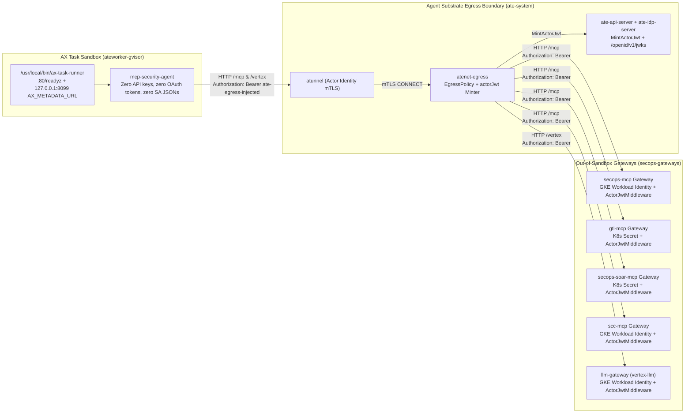

# Out-of-Sandbox Streamable HTTP MCP Gateway for AX and Agent Substrate

This directory deploys all four [`google/mcp-security`](../../README.md) servers (`secops`, `gti`, `secops-soar`, and `scc`) plus an out-of-sandbox Vertex AI Gemini proxy (`llm-gateway`) in Kubernetes so autonomous security agents running on [AX](https://github.com/google/ax) (`ax.io/v1alpha1`) and [Agent Substrate](https://github.com/agent-substrate/substrate) (`ate.dev`) execute MCP tools and LLM calls with **zero cloud or API credentials inside the sandbox**.

## Architecture



### Security Properties

1. **Zero Credentials in the Sandbox**: The AX `Task` runs with `AX_ZERO_SECRET_SANDBOX=true` and `MCP_GATEWAY_AUTH_HEADER="Bearer ate-egress-injected"`. Before Pydantic settings load any `.env` file, `verify_zero_secret_sandbox()` inspects `os.environ`, `/proc/self/environ`, and standard mounted credential paths (`~/.config/gcloud`, `/var/run/secrets/kubernetes.io/serviceaccount/token`), disables `.env` file loading and stdio MCP fallback, and fails closed if any cloud credential path, OAuth access token, or vendor API key is present.
2. **No MITM Trust Bundle Required Inside the Sandbox**: Because the agent invokes all four MCP gateways (`Workspace.spec.mcp.servers[].endpoint`) and the out-of-sandbox Vertex AI proxy (`LLM_GATEWAY_URL`) over cluster-internal HTTP, `atenet-egress` applies `http` `replaceHeaders` rules directly without requiring TLS interception or mounting a custom CA bundle inside AX's `BuildActorTemplate`.
3. **Cryptographic `actorJwt` Caller Verification with Live Key Rotation**: `atenet-egress` replaces the sandbox's placeholder `Authorization` header on the wire with a short-lived `actorJwt` (`sub: actor/<atespace>/<task>`, claim `actor.ate.dev`, scoped `aud` per gateway Service). Each gateway's `ActorJwtMiddleware` fetches public signing keys asynchronously from `ate-idp-server` (`${ACTOR_JWT_ISSUER}/openid/v1/jwks`) verified against Substrate's projected `servicedns-ca` `ClusterTrustBundle`, and enforces RFC 7517 JWKS signatures (`ES256` / `RS256` / `RS384` / `RS512`), mandatory `iss`, `aud`, `exp`/`nbf`, `KindActor` invariants (rejecting `worker-for-actor.ate.dev` tokens), and `GATEWAY_ALLOWED_ATESPACES` / `GATEWAY_ALLOWED_ACTORS` allowlists.
4. **NetworkPolicy Isolation**: `allow-only-atenet-egress` (`manifests/mcp-gateways-k8s.yaml`) drops direct pod-to-pod traffic to port `8080` in `secops-gateways`, admitting connections exclusively from `atenet-egress` pods in `ate-system`.
5. **AX Custom Task Image & Kubelet Probe Contracts**: `Dockerfile.ax-agent` installs `/usr/local/bin/ax-task-runner` (`ax_task_runner.py`), fulfilling AX's `BuildActorTemplate` contract (`:80/healthz` and `:80/readyz` wakeup probe, loopback `AX_METADATA_URL` metadata server, idempotent `/workspace` file initialization across gVisor suspend/resume, and `Task.spec.command` supervision). On the gateways, outer `/healthz` and `/readyz` probes respond before `ActorJwtMiddleware` and `Host` validation so kubelet probes targeting `<pod-ip>:8080` succeed while `/mcp` and `/vertex` enforce Service DNS `Host` allowlists.

## Directory Layout

- `src/ax_mcp_gateway/actor_jwt.py`: Async Agent Substrate `KindActor` JWT + RFC 7517 JWKS verifier (supporting live OIDC JWKS over `GATEWAY_JWKS_CA_FILE` and static `GATEWAY_JWKS_PATH`) and ASGI `ActorJwtMiddleware`.
- `src/ax_mcp_gateway/gateway.py`: Multi-server Streamable HTTP and LLM gateway launcher (`mcp-security-gateway`) wrapping `secops`, `gti`, `secops-soar`, `scc`, and `vertex-llm` with `/healthz`, `/readyz`, and cluster DNS `Host` allowlists.
- `src/ax_mcp_gateway/llm_proxy.py`: Out-of-sandbox `actorJwt`-authenticated Vertex AI Gemini HTTP reverse proxy (`/vertex/v1/...` and `/vertex/v1beta1/...`).
- `src/ax_mcp_gateway/ax_task_runner.py`: `/usr/local/bin/ax-task-runner` implementation for custom AX `Task` container images.
- `Dockerfile`: Multi-stage non-root (`65532:65532`) gateway container build accepting `--build-arg SERVER_TARGET=secops|gti|secops-soar|scc|vertex-llm`.
- `Dockerfile.ax-agent`: Zero-secret AX `Task` container build packaging `mcp-security-agent` and `/usr/local/bin/ax-task-runner`.
- `manifests/mcp-gateways-k8s.yaml`: Kubernetes `Namespace`, Workload Identity `ServiceAccount`s, `NetworkPolicy`, and hardened `Deployment` + `Service` resources for all four MCP gateways plus `llm-gateway`.
- `manifests/sandbox-and-workerpool.yaml`: Agent Substrate `ate.dev/v1` `WorkerPool` referencing Substrate's cluster-installed `gvisor-default` `SandboxConfig`.
- `manifests/egress-policy.yaml`: Single-document `ateapi.v1.EgressPolicy` protojson manifest injecting per-service `actorJwt` headers across all five gateways on port `8080`.
- `manifests/ax-secops-gateway-task.yaml`: Multi-document `ax.io/v1alpha1` `Workspace` (declaring all four `spec.mcp.servers[].endpoint` URLs) and digest-pinned `Task`.

## Deployment Steps

### 1. Build and Push Digest-Pinned Images

```bash
export PROJECT_ID="my-secops-project"
export REGISTRY="us-docker.pkg.dev/$PROJECT_ID/secops-mcp"

for SERVER_TARGET in secops gti secops-soar scc vertex-llm; do
  docker build -f deployments/ax-mcp-gateway/Dockerfile \
    --build-arg SERVER_TARGET="$SERVER_TARGET" \
    -t "$REGISTRY/${SERVER_TARGET}-mcp-gateway:v0.1.0" .
  docker push "$REGISTRY/${SERVER_TARGET}-mcp-gateway:v0.1.0"
done

docker build -f deployments/ax-mcp-gateway/Dockerfile.ax-agent \
  -t "$REGISTRY/mcp-security-agent:v0.1.0" .
docker push "$REGISTRY/mcp-security-agent:v0.1.0"
```

Record each pushed `@sha256:...` digest and update the `image:` references in `manifests/mcp-gateways-k8s.yaml` and `manifests/ax-secops-gateway-task.yaml`.

### 2. Deploy the Out-of-Sandbox MCP and Vertex AI Gateways

Create the gateway secrets for `gti-mcp` and `secops-soar-mcp` (while `secops-mcp`, `scc-mcp`, and `llm-gateway` authenticate via GKE Workload Identity) and apply `manifests/mcp-gateways-k8s.yaml`. Each gateway verifies `actorJwt` tokens dynamically against `ate-idp-server` (`${ACTOR_JWT_ISSUER}/openid/v1/jwks`) using Substrate's projected `servicedns-ca` `ClusterTrustBundle` (if inspecting raw cluster JWKS offline, read `kubectl -n ate-system get secret actor-id-jwt-pool -o jsonpath='{.data.jwks}' | base64 -d`):

```bash
export PROJECT_ID="my-secops-project"
export GOOGLE_CLOUD_LOCATION="global"
export CHRONICLE_PROJECT_ID="my-secops-project"
export CHRONICLE_CUSTOMER_ID="00000000-0000-0000-0000-000000000000"
export CHRONICLE_REGION="us"
export SOAR_URL="https://example.siemplify-soar.com"
export SOAR_INTEGRATIONS="Siemplify"
export ACTOR_JWT_ISSUER="https://idp.ate-system.svc"
export REAL_VT_APIKEY="<your-virustotal-apikey>"
export REAL_SOAR_APP_KEY="<your-soar-app-key>"

kubectl create namespace secops-gateways --dry-run=client -o yaml | kubectl apply -f -

kubectl create secret generic gti-mcp-credentials \
  --namespace="secops-gateways" \
  --from-literal=VT_APIKEY="$REAL_VT_APIKEY"

kubectl create secret generic secops-soar-mcp-credentials \
  --namespace="secops-gateways" \
  --from-literal=SOAR_APP_KEY="$REAL_SOAR_APP_KEY"

envsubst '${PROJECT_ID} ${GOOGLE_CLOUD_LOCATION} ${CHRONICLE_PROJECT_ID} ${CHRONICLE_CUSTOMER_ID} ${CHRONICLE_REGION} ${SOAR_URL} ${SOAR_INTEGRATIONS} ${ACTOR_JWT_ISSUER}' \
  < deployments/ax-mcp-gateway/manifests/mcp-gateways-k8s.yaml | kubectl apply -f -
```

### 3. Apply Agent Substrate WorkerPool, AX Manifests, `EgressPolicy`, and Resume Task

`ax apply` creates tasks in `Suspended` state. Attach the actor's `EgressPolicy` before calling `ax resume task` so outbound MCP and LLM calls are authorized immediately on wakeup:

```bash
export PROJECT_ID="my-secops-project"
export GOOGLE_CLOUD_LOCATION="global"
export ATESPACE="secops"
export TASK_NAME="secops-triage-agent"
export WORKLOAD_NAMESPACE="ate-workloads"
export ATEWORKER_GVISOR_IMAGE="us-docker.pkg.dev/$PROJECT_ID/ate-system/ateworker-gvisor@sha256:<ateworker-digest>"

kubectl create namespace "$WORKLOAD_NAMESPACE" --dry-run=client -o yaml | kubectl apply -f -
envsubst '${ATEWORKER_GVISOR_IMAGE}' \
  < deployments/ax-mcp-gateway/manifests/sandbox-and-workerpool.yaml | kubectl apply -f -

envsubst '${PROJECT_ID} ${GOOGLE_CLOUD_LOCATION}' \
  < deployments/ax-mcp-gateway/manifests/ax-secops-gateway-task.yaml \
  | ax apply -a "$ATESPACE" -f -

kubectl ate create egress-policy "$TASK_NAME" \
  --atespace "$ATESPACE" \
  -f deployments/ax-mcp-gateway/manifests/egress-policy.yaml

ax resume task "$TASK_NAME" -a "$ATESPACE"
```

### 4. Verify End-to-End Zero-Secret Execution

```bash
export ATESPACE="secops"
export TASK_NAME="secops-triage-agent"

kubectl -n secops-gateways rollout status \
  deployment/secops-mcp \
  deployment/gti-mcp \
  deployment/secops-soar-mcp \
  deployment/scc-mcp \
  deployment/llm-gateway
kubectl ate get egress-policy "$TASK_NAME" --atespace "$ATESPACE" -o json
ax get tasks -a "$ATESPACE"
ax describe task "$TASK_NAME" -a "$ATESPACE"
```

## Running Tests Locally

```bash
uv run --directory run-with-google-adk --extra test pytest \
  ../deployments/ax-mcp-gateway/tests \
  tests/
```

### Live Multi-Gateway & Zero-Secret ADK Agent Smoke Test

When configured with a test Google SecOps tenant (`CHRONICLE_PROJECT_ID`,
`CHRONICLE_CUSTOMER_ID`, `SOAR_URL`, `SOAR_APP_KEY`) and `VT_APIKEY`, run the
multi-process live end-to-end harness to launch all five out-of-sandbox gateways
(`secops`, `gti`, `secops-soar` with `SOAR_INTEGRATIONS=Siemplify`, `scc`, and
`vertex-llm`) with ES256 `actorJwt` JWKS enforcement, an `atenet-egress`
mediation proxy, and an isolated `AX_ZERO_SECRET_SANDBOX=true` ADK agent child
process:

```bash
REPO_ROOT="$(pwd)"
python -P "$REPO_ROOT/deployments/ax-mcp-gateway/scripts/verify_live_gateways.py"
```
