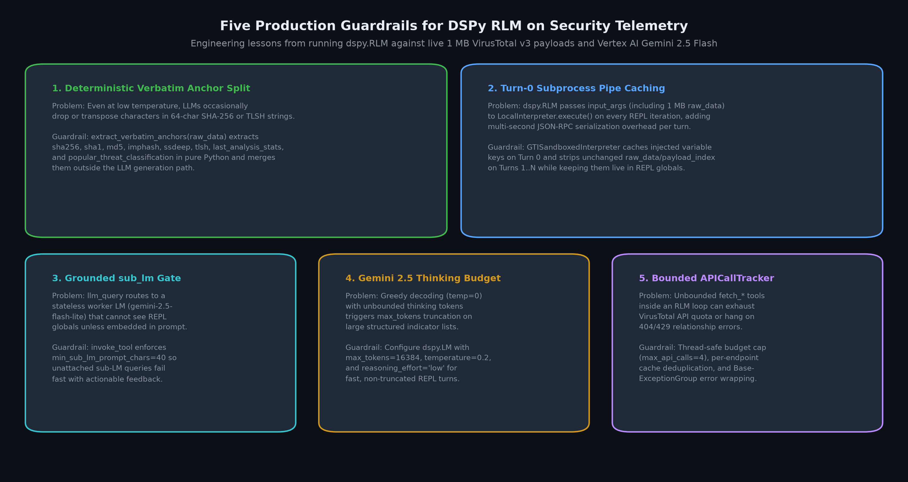

# Distilling 1 MB threat intelligence payloads with DSPy Recursive Language Models

When an autonomous Security Operations Center (SOC) agent investigates a suspicious binary, its first instinct is to pull the file report and dynamic sandbox behavior from Google Threat Intelligence (GTI) and the VirusTotal v3 API. That instinct is sound for a human analyst clicking through tabs in a browser. For an LLM agent operating through the Model Context Protocol (MCP), it is a context window disaster.

A single call to `GET /files/{hash}/behaviour_summary` for a well-known ransomware sample like WannaCry (`24d004a104d4d54034dbcffc2a4b19a11f39008a575aa614ea04703480b1022c`) returns **998,460 bytes** of raw JSON. Even after stripping empty nulls and links with `utils.sanitize_response`, the payload still weighs **867,904 bytes**, or roughly 220,000 tokens. Over 95% of those bytes are benign operating system and sandbox background noise: thousands of Windows Error Reporting (`WER`) temporary file reads, `SyncRootManager` registry lookups, `MSIExecute` mutexes, standard Win32 DLL loads, and `.ttf` font opens.

In this post, I explain how I built five new DSPy 3.4+ Recursive Language Model (`dspy.RLM`) tools for the Google Threat Intelligence MCP server (`server/gti`) in my fork of [`google/mcp-security`](https://github.com/google/mcp-security). By keeping raw VirusTotal v3 payloads out of the host model's context window and mounting them inside a sandboxed Python REPL driven by Gemini 3.8 Flash and Gemini 3.5 Flash-Lite on Vertex AI, I reduced live payload sizes by **84.53% to 98.49%** while retaining 100% of high-signal indicators and guaranteeing zero cryptographic hash hallucinations.


---

## Why security telemetry breaks standard MCP tool calling

Modern frontier models advertise million-token context windows, which makes it tempting to return raw API responses directly from MCP tools. In practice, stuffing hundreds of kilobytes of raw JSON into an agent's conversation history causes three distinct failures during multi-step security investigations.

**Context rot and lost-in-the-middle attention dilution.** Liu et al. demonstrated in *"Lost in the Middle: How Language Models Use Long Contexts"* ([arXiv:2307.03172](https://arxiv.org/abs/2307.03172)) that transformer retrieval accuracy drops sharply when relevant facts are buried inside long inputs. Hong et al. at Chroma Research extended this finding in their 2025 technical report *"Context Rot: How Increasing Input Tokens Impacts LLM Performance"* ([Chroma Context Rot Report](https://research.trychroma.com/context-rot)), showing that distraction tokens actively degrade multi-hop reasoning even when the needle is technically within the context limit. When a single `behaviour_summary` call injects 385 KB of `files_opened` noise and 290 KB of benign `registry_keys_opened` reads between the WannaCry kill-switch DNS lookup (`www.iuqerfsodp9ifjaposdfjhgosurijfaewrwergwea.com`) and the Windows service creation (`T1543.003`), the host agent loses track of the attack chain.

**Hard field exclusion blinds the analyst.** The existing [`get_file_report`](servers/gti_mcp.md) tool in `google/mcp-security` works around payload size by passing `exclude_attributes="last_analysis_results"` to the VirusTotal v3 API. That cuts the payload down to 50,286 bytes, but it throws away all 76 individual security vendor detection names. If an analyst asks which engines classified the binary as `WannaCry` versus a generic `Trojan` or whether any vendor flagged `CVE-2017-0147` (`EternalBlue`), the data is already gone. Worse, attempts to apply static field exclusion lists to sandbox behavior reports (such as dropping `command_executions` or `processes_tree` to save space, which I tracked in [`google/mcp-security` Issue #327](https://github.com/google/mcp-security/issues/327)) strip out the exact process trees and command lines needed to write a detection rule.

**Syntactic compression hits a semantic ceiling.** Before turning to Recursive Language Models, I experimented with [TOON (Token-Oriented Object Notation)](https://github.com/toon-format/toon) to compress MCP tool responses. TOON is a clever serialization format that factors repeated keys out of homogeneous JSON object arrays into a tabular header, cutting syntactic overhead from braces, quotes, and duplicate field names by 35% to 45%. However, TOON is lossless syntactic repacking. If a VirusTotal sandbox report contains 4,000 benign `C:\ProgramData\Microsoft\Windows\WER\Temp\WER*.tmp` file operations, TOON faithfully encodes all 4,000 rows into a slightly smaller table. What security telemetry needs is semantic distillation in code, not just tighter punctuation.


---

## Theoretical foundation: Recursive Language Models and DSPy 3.4+

To solve this properly, I drew on two foundational bodies of research and applied them to Google's security MCP ecosystem.

### 1. Recursive Language Models (Zhang, Kraska, & Khattab, 2025)

In *"Recursive Language Models"* ([arXiv:2512.24601](https://arxiv.org/abs/2512.24601)), Alex L. Zhang, Tim Kraska, and Omar Khattab (MIT CSAIL) introduce a general inference strategy for unbounded context lengths. Rather than feeding a massive payload $P$ directly into a transformer's context window, an RLM mounts $P$ as an external variable inside an interactive Python Read-Eval-Print Loop (REPL).

The root language model sees only the user's query and a compact metadata description of the environment. Across a bounded number of turns, the root LM writes executable Python code to inspect keys, compute collection lengths, filter arrays with regular expressions or set comprehensions, and optionally invoke a recursive sub-LM (`llm_query` or `llm_query_batched`) on small, isolated text slices. Once the root LM has assembled the exact evidence it needs, it calls `SUBMIT(...)` to terminate the loop and return a structured result.

### 2. Declarative compilation with DSPy (`dspy.RLM`)

In *"DSPy: Compiling Declarative Language Model Calls into Self-Improving Pipelines"* ([arXiv:2310.03714](https://arxiv.org/abs/2310.03714), ICLR 2024), Khattab et al. showed how to replace brittle prompt templates with typed Python signatures (`dspy.Signature`) and composable modules. Starting in DSPy 3.4+, the [`dspy.RLM` module](https://dspy.ai/current/diving-deeper/rlm/) brings Recursive Language Models directly into DSPy's declarative programming model.

In my implementation (`server/gti/gti_mcp/rlm_engine.py`), I defined `GTIPayloadDistillSignature(dspy.Signature)` to specify the exact contract between the raw VirusTotal v3 payload in the REPL and the distilled threat intelligence dictionary returned to the MCP client:

```python
class GTIPayloadDistillSignature(dspy.Signature):
  """Explore a Google Threat Intelligence (VirusTotal v3) payload in Python to extract high-signal threat intelligence."""

  entity_id: str = dspy.InputField(desc="Target file hash or behaviour ID.")
  tool_name: str = dspy.InputField(desc="MCP tool name being executed.")
  query: str = dspy.InputField(
      desc="Specific analyst question or triage objective."
  )
  payload_index: dict[str, Any] = dspy.InputField(
      desc="Compact structural index of top-level keys, collection lengths, and benign noise counts."
  )
  raw_data: Any = dspy.InputField(
      desc="Full un-truncated VirusTotal v3 JSON payload (dict or list) loaded in the Python REPL."
  )

  verdict_and_summary: str = dspy.OutputField(
      desc="Concise executive threat assessment (verdict, malware family, severity, and primary capability)."
  )
  answer: str = dspy.OutputField(
      desc="Direct, evidence-backed answer to `query`."
  )
  key_findings: list[str] = dspy.OutputField(
      desc="Bullet list of grounded technical findings."
  )
  high_signal_iocs: dict[str, list[str]] = dspy.OutputField(
      desc="Dict with keys: network, files_dropped_or_modified, process_and_command_lines, persistence_and_mutexes, yara_and_sigma_matches."
  )
  attributions: list[dict[str, str]] = dspy.OutputField(
      desc="List of associated threat actors, malware families, campaigns, or reports: [{'id': ..., 'name': ..., 'collection_type': ...}]."
  )
  mitre_techniques: list[dict[str, str]] = dspy.OutputField(
      desc="List of MITRE ATT&CK techniques: [{'id': ..., 'name': ..., 'evidence': ...}]."
  )
  filtered_noise_summary: str = dspy.OutputField(
      desc="Summary of noisy/benign fields and entries omitted during distillation."
  )
```

### 3. Pairing Gemini 3.8 Flash and Gemini 3.5 Flash-Lite on Vertex AI

To execute `dspy.RLM` efficiently in production, I paired two models from Google's [Gemini 3 model family on Vertex AI](https://cloud.google.com/vertex-ai/generative-ai/docs/models):

- **Root REPL controller (`vertex_ai/gemini-3.8-flash`):** Handles Python code generation, schema exploration, and cross-indicator correlation across REPL turns, served on the global Vertex AI endpoint (`vertex_location="global"`) and configured with `reasoning_effort="low"` so internal thinking tokens remain fast and bounded.
- **Recursive worker (`vertex_ai/gemini-3.5-flash-lite`):** Serves `llm_query` and `llm_query_batched` calls inside the REPL when the root model wants semantic summarization of unstructured report descriptions or GTI Code Insights.

When these GTI RLM MCP tools are consumed by an upstream agent built with the [Google Agent Development Kit (ADK)](https://google.github.io/adk-docs/) (such as the autonomous SOC agent in [`run-with-google-adk`](https://github.com/google/mcp-security/blob/main/run-with-google-adk/README.md)), the host ADK agent receives a 3 KB to 15 KB structured summary instead of a 1 MB raw dump, keeping its context window clean across dozens of investigative steps.

---

## Anatomy of a 1 MB VirusTotal behavior summary

To see why out-of-core Python filtering works so well on security telemetry, look at where the bytes actually go inside the 998.5 KB VirusTotal v3 `/files/{hash}/behaviour_summary` response for WannaCry (`24d004a104d4d54034dbcffc2a4b19a11f39008a575aa614ea04703480b1022c`).


Over 98% of the raw payload consists of repetitive Windows background activity recorded by multiple sandboxes (CAPE, Zenbox, Tencent HABO, Jujubox):

1. **`files_opened` and `files_written` clutter (~385 KB):** Hundreds of temporary crashpad and Windows Error Reporting files (`C:\ProgramData\Microsoft\Windows\WER\Temp\WER*.tmp.WERInternalMetadata.xml`), `.nls` locale tables, and font caches.
2. **`registry_keys_opened` clutter (~290 KB):** Background queries to `HKLM\Software\Microsoft\Windows\CurrentVersion\Explorer\SyncRootManager` and COM class registrations.
3. **`modules_loaded` and benign Win32 DLLs (~165 KB):** Standard Windows runtime libraries loaded by every Win32 executable.
4. **Duplicate multi-sandbox mutexes (~140.5 KB):** Benign Internet Explorer and Windows zone cache mutexes (`Local\ZonesCacheCounterMutex`, `RasPbFile`, `Local\!IETld!Mutex`).

Inside `server/gti/gti_mcp/rlm_engine.py`, I give the RLM both a pre-computed `payload_index` (which summarizes collection lengths and noise counts before Turn 0) and a helper function `compact_behavior_for_repl()` that strips known benign sandbox patterns (`SyncRootManager`, `MSIExecute`, `WER\Temp\WER`, Fonts/Adobe/NLS reads) whenever the RLM fetches behavioral data. What survives inside the **13,073-byte** RLM output (`98.49%` reduction) is pure signal:

- The exact command-line launch chain (`C:\Windows\system32\cmd.exe /c "START /MIN cmd.exe /c "C:\XXX\lhdfrgui.exe""` and `%WINDIR%\explorer.exe -> %SAMPLEPATH%\lhdfrgui.exe`).
- The WannaCry kill-switch DNS query (`www.iuqerfsodp9ifjaposdfjhgosurijfaewrwergwea.com`) and external C2 IP connections (`113.19.145.202`, `213.61.66.116`, `104.16.167.228`).
- All 34 MITRE ATT&CK techniques observed across sandboxes, including `T1543.003` (Windows service creation and persistence), `T1486` (ransomware document encryption), `T1070.004` (shadow volume deletion), `T1490` (`bcdedit` boot configuration modification), `T1135` (SMB lateral movement across private subnets), and `T1090.003` (Tor anonymizer installation).
- An explicit `filtered_noise_summary` audit string documenting how many benign command executions, system mutexes, and Microsoft background DNS queries were omitted.

---

## Five new GTI RLM MCP tools

I added five tools in `server/gti/gti_mcp/tools/rlm_files.py`, keeping all existing GTI tools untouched so MCP clients can adopt RLM distillation incrementally:

1. **`rlm_get_file_report(hash, ctx, query=None)` (1 VT API call):** Fetches `GET /files/{hash}` *without* excluding `last_analysis_results`. All 76 vendor results stay inside the Python REPL so the RLM can compute vendor consensus and extract CVE/exploit references while omitting `undetected` vendor rows and bulky PE import tables.
2. **`rlm_get_file_behavior_summary(hash, ctx, query=None)` (1 VT API call):** Distills `GET /files/{hash}/behaviour_summary` (`~1 MB` raw) into high-signal process trees, command lines, persistence registry modifications, non-noisy mutexes, dropped files, network C2 traffic, and MITRE ATT&CK techniques.
3. **`rlm_get_file_behavior_report(file_behaviour_id, ctx, query=None)` (1 VT API call):** Distills an individual sandbox execution report (`GET /file_behaviours/{file_hash}_{sandbox_name}`).
4. **`rlm_get_entities_related_to_a_file(hash, relationship_name, ctx, descriptors_only=False, limit=10, query=None)` (1 VT API call):** Fetches full related entity objects (such as `contacted_domains`, `contacted_ips`, `dropped_files`, or `associations`) and compresses them in the REPL.
5. **`rlm_investigate_file(hash, ctx, investigation_goal=None, max_api_calls=4)` (Multi-call autonomous investigator):** Seeds the RLM REPL with `GET /files/{hash}` and binds four VirusTotal pivot functions directly into the Python sandbox:
   - `fetch_behavior_summary()`
   - `fetch_sandbox_report(sandbox_id)`
   - `fetch_related_entities(relationship_name, limit=10)`
   - `fetch_collection_summary(collection_id)`


When I run `rlm_investigate_file` on WannaCry with `max_api_calls=3`, the RLM inspects the static file report on Turn 0, notices the `WannaCry_Ransomware` YARA matches and 68 malicious vendor detections, and autonomously calls `fetch_behavior_summary()` inside the Python REPL. It correlates the static PE masquerading (`lhdfrgui.exe`, `imphash` `9ecee117164e0b870a53dd187cdd7174`) and crowdsourced YARA/IDS rules with the dynamic kill-switch DNS query (`www.iuqerfsodp9ifjaposdfjhgosurijfaewrwergwea.com`) and service persistence (`T1543.003`, `T1569.002`), compressing **920,367 bytes** across 2 VirusTotal API calls into a single **14,875-byte** investigative report (`98.38%` reduction) in 2 REPL turns.

---

## Live compression benchmarks on VirusTotal v3 and Vertex AI

I benchmarked the tools against live VirusTotal v3 endpoints and Vertex AI (`vertex_ai/gemini-3.8-flash` root model + `vertex_ai/gemini-3.5-flash-lite` sub-model) on WannaCry (`24d004a104d4d54034dbcffc2a4b19a11f39008a575aa614ea04703480b1022c`).


| Tool | Raw Sanitized VT Payload | RLM Distilled Output | Byte Reduction | VT API Calls | RLM REPL Turns |
| :--- | ---: | ---: | ---: | ---: | ---: |
| `rlm_get_file_report` | `52,463 B` | `8,117 B` | **84.53%** | `1` | `3` |
| `rlm_get_file_behavior_summary` | `867,904 B` (`998,460 B` raw) | `13,073 B` | **98.49%** | `1` | `3` |
| `rlm_get_entities_related_to_a_file` (`contacted_domains`) | `116,330 B` | `2,996 B` | **97.42%** | `1` | `2` |
| `rlm_investigate_file` (`/files/{hash}` + `/behaviour_summary`) | `920,367 B` | `14,875 B` | **98.38%** | `2` | `2` |

---

## Head-to-head SOC investigation: without vs. with the RLM refactor

Single-endpoint byte compression only tells half the story. In a real incident response workflow, an agent conducts a multi-turn investigation: it triages the primary file report (Turn 1), inspects dynamic sandbox behavior (Turn 2), and pivots into network infrastructure and dropped artifacts (Turn 3). Because conversational agents re-send prior turns on every subsequent step, raw tool payloads compound quadratically across the session.

To measure the end-to-end impact on a host SOC agent (`vertex_ai/gemini-3.8-flash`), I wrote [`server/gti/examples/compare_baseline_vs_rlm_investigation.py`](https://github.com/google/mcp-security) and ran the exact same multi-artifact WannaCry investigation (primary dropper `24d004a104d4d54034dbcffc2a4b19a11f39008a575aa614ea04703480b1022c` plus dropped shortcut artifact `0a989a89d77d48f9a25ec64cb30043896bc976e85b8940b59dcf2afce2797227`) across three modes:

1. **Mode 1 — Baseline (Without Refactor):** Uses the legacy raw tools (`get_file_report`, `get_file_behavior_summary`, `get_entities_related_to_a_file`) across 3 host turns.
2. **Mode 2 — Refactored Stepwise RLM (`rlm_get_*`):** Uses `rlm_get_file_report`, `rlm_get_file_behavior_summary`, and `rlm_get_entities_related_to_a_file` across the same 3 host turns.
3. **Mode 3 — Refactored Autonomous RLM (`rlm_investigate_file`):** Uses `rlm_investigate_file` to correlate static and dynamic telemetry inside the sandboxed Python REPL and synthesize the investigation in a single host turn.


| Investigation Metric | 1. Baseline Raw Tools (Without Refactor) | 2. Stepwise RLM (`rlm_get_*`) | 3. Autonomous RLM (`rlm_investigate_file`) |
| :--- | ---: | ---: | ---: |
| **Host Context Tool Bytes Injected** | `1,030,327 B` (`1.03 MB`) | `27,087 B` (**-97.37%**) | `21,083 B` (**-97.95%**) |
| **Turn 1 Host Prompt Tokens** | `18,864` | `4,486` | `9,579` (single turn) |
| **Turn 2 Host Prompt Tokens** | `423,870` | `10,074` | — |
| **Turn 3 Host Prompt Tokens** | `467,732` | `15,426` | — |
| **Cumulative Host Prompt Tokens Billed** | **`910,466`** | **`29,986` (-96.71%)** | **`9,579` (-98.95%)** |
| **Host Agent LLM Synthesis Time** | `109.92 s` | `42.63 s` (`2.6x` faster) | `25.51 s` (`4.3x` faster) |
| **76-Vendor Engine Signatures Visible?** | **No** (stripped by `exclude_attributes`) | **Yes** (analyzed in REPL) | **Yes** (analyzed in REPL) |
| **15-Point Ground-Truth Rubric Recall** | `14 / 15` (`93.3%`) | **`15 / 15` (`100.0%`)** | **`15 / 15` (`100.0%`)** |

Two qualitative differences stand out when comparing the transcripts side by side:

- **Eliminating the `exclude_attributes` blind spot:** In Mode 1 (Baseline), `get_file_report` hardcodes `params={"exclude_attributes": "last_analysis_results"}` to keep the raw JSON under 50 KB. When asked for specific vendor classifications from Kaspersky, Microsoft, and ESET, the baseline host agent had to report that per-vendor engine signatures were missing from the payload (`14/15` rubric score). In Modes 2 and 3, `rlm_get_file_report` and `rlm_investigate_file` load all 76 vendor results into the Python REPL and extract the exact signatures (`Kaspersky: Trojan-Ransom.Win32.Wanna.m`, `Microsoft: Ransom:Win32/WannaCrypt!pz`, `ESET-NOD32: Win32/Exploit.CVE-2017-0147.A trojan`, and on the dropped `.lnk` file `Symantec: Ransom.Wannacry`, `Skyhigh: Ransom-WannaCry!lnk`) while discarding undetected rows (`15/15` rubric score).
- **Preventing multi-turn token compounding:** In Mode 1, injecting `867,904 bytes` of raw `behaviour_summary` on Turn 2 swells the host prompt to `423,870 tokens`, and Turn 3 re-sends that entire buffer plus `123,824 bytes` of domain and dropped-file JSON (`467,732 tokens`), billing **910,466 cumulative prompt tokens** for a single investigation. Modes 2 and 3 reduce cumulative host prompt tokens by **96.71%** (`29,986 tokens`) and **98.95%** (`9,579 tokens`), cutting host LLM synthesis time from `109.92s` to `42.63s` and `25.51s`.

---

## Five production guardrails I built into `GTISandboxedInterpreter`

Running `dspy.RLM` against synthetic unit tests is straightforward; running it reliably against 1 MB live VirusTotal v3 payloads on Vertex AI surfaced five engineering edge cases that required dedicated guardrails in `server/gti/gti_mcp/rlm_engine.py`.



### 1. Deterministic verbatim anchor split (`extract_verbatim_anchors`)

A single transposed character in a 64-character SHA-256 hash or a 72-character TLSH digest breaks downstream SIEM/EDR pivoting. Rather than asking the LLM to copy hashes into its `SUBMIT()` call, `extract_verbatim_anchors(raw_data)` extracts `sha256`, `sha1`, `md5`, `imphash`, `ssdeep`, `tlsh`, `meaningful_name`, `size`, `last_analysis_stats`, `popular_threat_classification`, `gti_assessment`, and `code_insights` deterministically in pure Python and merges them into the final dictionary outside the LLM generation path.

### 2. Turn-0 subprocess pipe caching in `GTISandboxedInterpreter.execute`

By default, `dspy.RLM` passes the full `input_args` dictionary (`variables={"raw_data": ...}`) into `LocalInterpreter.execute(code, variables)` on every REPL iteration. Because `LocalInterpreter` communicates with its sandbox worker over a JSON-RPC pipe, re-serializing an 868 KB `behaviour_summary` dictionary on Turns 1, 2, 3, and 4 adds seconds of serialization overhead even though the worker already holds `raw_data` in its top-level globals from Turn 0.

In `GTISandboxedInterpreter(LocalInterpreter)`, I track which heavy immutable keys (`raw_data`, `payload_index`, `entity_id`, `tool_name`, `query`) have been injected after `SHIM_SETUP` (`__dspy_host_token`) completes, and strip unchanged keys from `variables` on subsequent turns.

### 3. Grounded `sub_lm` gate (`min_sub_lm_prompt_chars=40`)

Inside the REPL, `llm_query` and `llm_query_batched` dispatch prompts to a stateless worker model (`vertex_ai/gemini-3.5-flash-lite`) that cannot see REPL variables unless the root model embeds a slice of `raw_data` into the prompt string. `GTISandboxedInterpreter.invoke_tool` rejects unattached short prompts (`< 40` characters) with a `ValueError` instructing the root LM to embed a concrete slice of `raw_data` or compute the filter directly in Python.

### 4. Tuning Gemini 3.8 Flash thinking budget and Gemini 3+ parameter defaults

When running `dspy.LM("vertex_ai/gemini-3.8-flash")` against the 868 KB WannaCry behavior summary on Vertex AI, two model-generation details matter. First, Gemini 3+ models on Vertex AI are served on the global endpoint (`vertex_location="global"`) and deprecate legacy sampling parameters (`temperature`, `top_p`, and `top_k`). Second, unbounded internal thinking tokens on large indicator lists can hit default output token limits (`LM response was truncated`). In `configure_gti_rlm_lms()`, I default `vertex_location="global"`, omit deprecated `temperature` flags on Gemini 3+ models unless explicitly overridden, and set `max_tokens=16384` with `reasoning_effort="low"` to eliminate truncation and cut per-turn latency.

### 5. Thread-safe `APICallTracker` and live VirusTotal v3 envelope normalization

During live testing, I also caught a subtle difference between `vt-py` live responses and typical unit test fixtures: `vt.Object.to_dict()` preserves the raw VirusTotal v3 relationship envelope `{"data": [...], "meta": {...}, "links": {...}}`, whereas mocked fixtures often use a flat list `[...]`. Unwrapping `{"data": ...}` envelopes in `_extract_relationships()` and wrapping bound REPL tool calls in a thread-safe `APICallTracker` (with `max_api_calls` enforcement, per-endpoint caching, and `BaseExceptionGroup` handling) ensures that an RLM investigation never exceeds its VirusTotal API quota or crashes on a missing relationship.

---

## Try it yourself

I included a runnable CLI script at `server/gti/examples/rlm_file_triage_demo.py` so you can reproduce every benchmark above against your own VirusTotal API key and Google Cloud project:

```bash
WORKTREE_DIR="/path/to/mcp-security"
SAMPLE_SHA256="24d004a104d4d54034dbcffc2a4b19a11f39008a575aa614ea04703480b1022c"
cd "$WORKTREE_DIR/server/gti"

# 1. Distill a full 76-vendor file report (52.5 KB -> 8.1 KB)
direnv exec "$WORKTREE_DIR" python3 examples/rlm_file_triage_demo.py \
  --hash "$SAMPLE_SHA256" \
  --tool report

# 2. Distill a ~1 MB multi-sandbox behaviour_summary (867.9 KB -> 13.1 KB)
direnv exec "$WORKTREE_DIR" python3 examples/rlm_file_triage_demo.py \
  --hash "$SAMPLE_SHA256" \
  --tool behavior

# 3. Distill full related entity objects (116.3 KB -> 3.0 KB)
direnv exec "$WORKTREE_DIR" python3 examples/rlm_file_triage_demo.py \
  --hash "$SAMPLE_SHA256" \
  --tool entities

# 4. Run a multi-call autonomous file investigation (920.4 KB -> 14.9 KB)
direnv exec "$WORKTREE_DIR" python3 examples/rlm_file_triage_demo.py \
  --hash "$SAMPLE_SHA256" \
  --tool investigate

# 5. Run the head-to-head SOC investigation comparison (Baseline vs. RLM)
direnv exec "$WORKTREE_DIR" python3 examples/compare_baseline_vs_rlm_investigation.py \
  --output-json /tmp/gti_rlm_comparison.json
```

---

## References and further reading

1. **Zhang, A. L., Kraska, T., & Khattab, O. (2025).** *Recursive Language Models.* MIT CSAIL, arXiv preprint [arXiv:2512.24601](https://arxiv.org/abs/2512.24601).
2. **Khattab, O., Singhvi, A., Maheshwari, P., Zhang, Z., Santhanam, K., Vardhamanan, S., Haq, S., Sharma, A., Joshi, T. T., Moazam, H., Miller, H., Zaharia, M., & Potts, C. (2024).** *DSPy: Compiling Declarative Language Model Calls into Self-Improving Pipelines.* International Conference on Learning Representations (ICLR 2024), [arXiv:2310.03714](https://arxiv.org/abs/2310.03714), and [DSPy `dspy.RLM` Documentation](https://dspy.ai/current/diving-deeper/rlm/).
3. **Hong, K., Troynikov, A., & Huber, J. (2025).** *Context Rot: How Increasing Input Tokens Impacts LLM Performance.* Chroma Research Technical Report, [https://research.trychroma.com/context-rot](https://research.trychroma.com/context-rot).
4. **Liu, N. F., Lin, K., Hewitt, J., Paranjape, A., Bevilacqua, M., Petroni, F., & Liang, P. (2024).** *Lost in the Middle: How Language Models Use Long Contexts.* Transactions of the Association for Computational Linguistics (TACL), [arXiv:2307.03172](https://arxiv.org/abs/2307.03172).
5. **TOON Contributors (2025).** *TOON: Token-Oriented Object Notation for LLMs.* [https://github.com/toon-format/toon](https://github.com/toon-format/toon).
6. **Google Cloud Security & Google Threat Intelligence (2025-2026).** [Google Threat Intelligence Overview](https://cloud.google.com/security/products/threat-intelligence), [VirusTotal v3 API Reference](https://docs.virustotal.com/reference/overview), and the open-source [Google `mcp-security` Repository](https://github.com/google/mcp-security).
7. **Google DeepMind & Google Cloud Vertex AI (2025-2026).** [Gemini Models on Vertex AI](https://cloud.google.com/vertex-ai/generative-ai/docs/models) and the [Google Agent Development Kit (ADK)](https://google.github.io/adk-docs/).
