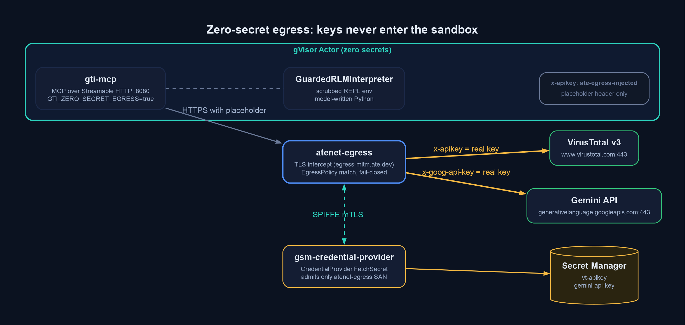
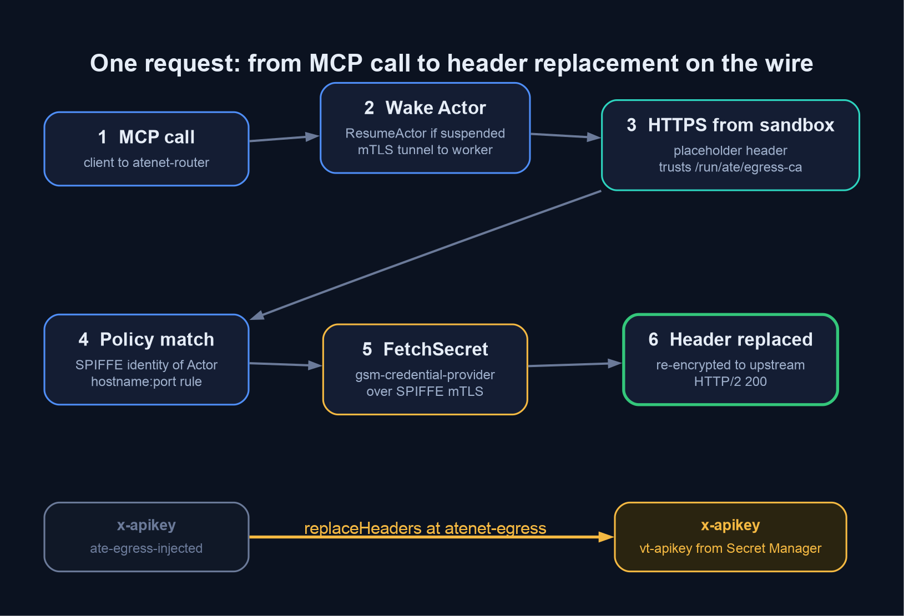
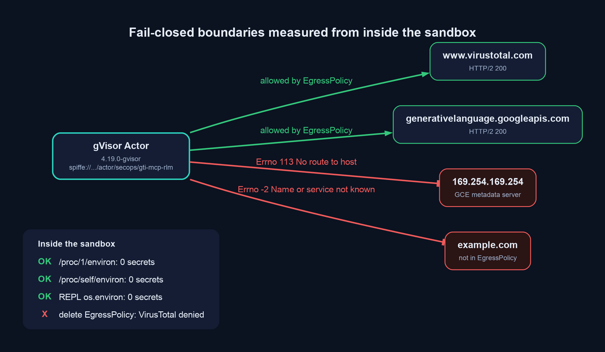
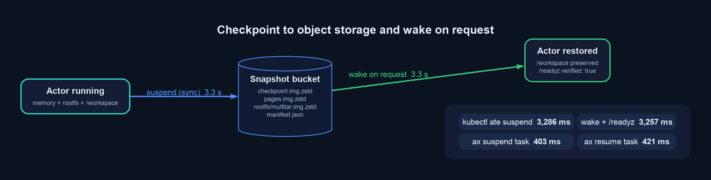

# Zero-Secret Sandboxing for the GTI MCP Server with Agent Substrate and AX

This page explains how the Google Threat Intelligence (GTI) MCP server and its DSPy RLM tools run inside a [gVisor](https://gvisor.dev/) sandbox on [Agent Substrate](https://github.com/agent-substrate/substrate) with no API keys anywhere inside the sandbox, how credentials are injected on the wire by the egress gateway, how egress is denied by default, and how the sandbox checkpoints to object storage and restores on demand. Every number quoted below was measured on a live GKE cluster running Agent Substrate `v1.0.0-rc.1`, the [Secret Manager credential provider](https://github.com/agent-substrate/credprovider-gcp-secret-manager), and [AX](https://github.com/google/ax) at commit `1dd2e92`.

The deployment manifests live in [`server/gti/deployments/agent-substrate/`](https://github.com/google/mcp-security/tree/main/server/gti/deployments/agent-substrate), and the supporting code is in [`server/gti/gti_mcp/egress.py`](https://github.com/google/mcp-security/blob/main/server/gti/gti_mcp/egress.py).

## Why move secrets out of the sandbox

The RLM tools (`rlm_get_file_report`, `rlm_investigate_file`, and friends) execute model-written Python against untrusted VirusTotal payloads inside a REPL. A prompt-injected sample or a buggy script running in that REPL could read `os.environ`, `/proc/self/environ`, or the cloud metadata server and exfiltrate a key. The standard mitigation is to scrub variables before spawning the REPL, which still leaves the real key resident in the parent process.

Agent Substrate removes the problem instead of mitigating it. The MCP server process, its REPL subprocess, and the whole gVisor guest never hold a real credential. They send a fixed placeholder header (`ate-egress-injected`) and an out-of-sandbox gateway swaps in the real value only for destinations an explicit policy allows.



## Components

| Component | Where it runs | Role |
| --- | --- | --- |
| `gti-mcp` (`GTI_ZERO_SECRET_EGRESS=true`) | Inside the gVisor Actor | Serves MCP over Streamable HTTP on `:8080`, exposes `/readyz`, runs `GuardedRLMInterpreter` with a scrubbed REPL environment, and fails closed at startup if any secret is found in `os.environ` or `/proc/*/environ`. |
| `ateworker-gvisor` (`WorkerPool`) | GKE node pool | Hosts sandboxes with `runsc` (`systrap` platform, sandboxed networking). Labeled `workload: gti-rlm-gvisor` so the `ActorTemplate.workerSelector` can target it. |
| `atenet-router` | `ate-system` | Receives inbound requests, wakes a suspended Actor on demand (`ResumeActor`), and tunnels traffic to the worker over mTLS. |
| `atenet-egress` | `ate-system` | Terminates sandbox TLS with a projected CA (`egress-mitm.ate.dev`), matches destinations against the Actor's `EgressPolicy`, and rewrites headers before re-encrypting to the upstream. |
| `gsm-credential-provider` | `ate-system` | gRPC `CredentialProvider` that resolves `ate-secret://secretmanager.googleapis.com/...` URIs from Google Cloud Secret Manager. Only `atenet-egress` can call it (SPIFFE SAN check plus a `NetworkPolicy` on port `50051`). |
| `ax-server` + `ax` CLI | `ax-system` | Declarative `Task` / `Workspace` / `Model` control plane that provisions the Actor, materializes `/workspace`, and drives `suspend` / `resume`. |

## Request lifecycle

One `rlm_get_file_report` call produces two kinds of outbound traffic from the sandbox: a VirusTotal v3 `GET /files/{hash}` and a handful of Gemini `generateContent` calls issued by `dspy.RLM`. Both follow the same path.



1. An MCP client calls the tool. If the Actor is suspended, `atenet-router` restores it from its last snapshot before forwarding the request.
2. `vt.Client` sends `x-apikey: ate-egress-injected` and `dspy.LM` sends `x-goog-api-key: ate-egress-injected`. Both clients trust `/run/ate/egress-ca/ca-bundle.crt` via `SSL_CERT_FILE`, so the TLS intercept at the gateway validates cleanly.
3. `atenet-egress` identifies the caller by its SPIFFE identity (`spiffe://substrate-actor.local/worker-for-actor/secops/gti-mcp-rlm`) and looks up that Actor's `EgressPolicy`.
4. For an allowed `hostname:port`, the policy's `replaceHeaders` effect names a `credentialUri`. The gateway calls `FetchSecret` on `gsm-credential-provider` over mTLS, which logs the resolving Actor and secret name without ever logging the value.
5. The header is overwritten on the wire and the request is re-encrypted to `www.virustotal.com` or `generativelanguage.googleapis.com`.

The policy that drives steps 3 and 4 is short:

```yaml
rules:
  - https:
      hostnames: ["www.virustotal.com"]
      ports: {numbers: [443]}
      effects:
        replaceHeaders:
          - header: "x-apikey"
            credentialUri: "ate-secret://secretmanager.googleapis.com/projects/${PROJECT_ID}/secrets/vt-apikey/versions/latest"
  - https:
      hostnames: ["generativelanguage.googleapis.com"]
      ports: {numbers: [443]}
      effects:
        replaceHeaders:
          - header: "x-goog-api-key"
            credentialUri: "ate-secret://secretmanager.googleapis.com/projects/${PROJECT_ID}/secrets/gemini-api-key/versions/latest"
```

`replaceHeaders` only rewrites headers that are already present on the request, which is why the clients send a placeholder rather than omitting the header.

## Fail-closed boundaries

There is no `defaultAction` in an `EgressPolicy`. Anything not matched by a rule is dropped, and an Actor with no policy at all has no egress. The sandbox also has no route to the GCE metadata server, so there is no ambient service-account token to steal.



Measured from inside the running sandbox (`uname -r` reports `4.19.0-gvisor`):

| Check | Result |
| --- | --- |
| `verify_zero_secret_sandbox_env()` on `os.environ` and `/proc/self/environ` | `verified: true`, zero findings |
| Same check on `/proc/1/environ` (the `ax-task-runner` parent) | `verified: true`, zero findings |
| `os.environ` scan from inside a `GuardedRLMInterpreter` REPL turn | no `*APIKEY*`, `*SECRET*`, `*TOKEN*`, or `*CREDENTIAL*` keys |
| `http://169.254.169.254/computeMetadata/v1/.../token` | `URLError: [Errno 113] No route to host` |
| `https://example.com` | `URLError: [Errno -2] Name or service not known` |
| `https://www.virustotal.com/api/v3/files/<sha256>` | `HTTP 200`, real report returned |
| `kubectl ate delete egress-policy gti-mcp-rlm` then retry the tool | tool returns an error within the gateway's 10 s policy cache window; recreating the policy restores access |

The REPL check matters because it is executed by code the model wrote, running in the same place a prompt-injected payload would run.

## What the RLM tools returned from inside the sandbox

With the real keys injected at the gateway, the DSPy RLM path ran end to end (`rlm_mode: dspy_rlm`, not the deterministic fallback) against the WannaCry sample `24d004a104d4d54034dbcffc2a4b19a11f39008a575aa614ea04703480b1022c`:

| Tool | VT API calls | Raw bytes | Returned bytes | Reduction | RLM turns |
| --- | ---: | ---: | ---: | ---: | ---: |
| `rlm_get_file_report` | 1 | 52,425 | 8,071 | 84.6% | 3 |
| `rlm_investigate_file` (`max_api_calls=2`) | 2 | 920,502 | 14,630 | 98.4% | 2 |

Both results preserved the verbatim SHA-256, SHA-1, MD5, and imphash anchors and reported 67 of 76 engines flagging the file. The `atenet-egress` access log for the same window shows only `HTTP/2 200` entries to the two allowed authorities, each tagged with the Actor's SPIFFE SAN, and `gsm-credential-provider` logged one `resolving credential` line per injected header.

## Checkpoint and restore

Agent Substrate suspends idle Actors to object storage and restores them when the router sees traffic. Two levels were exercised.



| Operation | Fidelity | Measured |
| --- | --- | ---: |
| `kubectl ate suspend actor gti-mcp-rlm --mode=sync` | memory + rootfs (`checkpoint.img`, `pages.img`, `rootfs/multitar.img`) | 3,286 ms |
| Wake on request (`kubectl ate proxy actor` until `/readyz` returns) | restore from the same snapshot | 3,257 ms |
| `ax suspend task gti-rlm-file-investigator` | volumes (`/workspace` durable dir) | 403 ms |
| `ax resume task gti-rlm-file-investigator` | volumes | 421 ms |

A marker file written to `/workspace` before `ax suspend task` was intact after `ax resume task`, and `/readyz` reported `zero_secret_egress: true, verified: true` immediately after every restore, so the zero-secret invariant survives the checkpoint path too.

## Deploying it yourself

The step-by-step runbook, including the `SandboxConfig`, `WorkerPool`, `ActorTemplate`, `EgressPolicy`, and AX manifests, is in [`server/gti/deployments/agent-substrate/README.md`](https://github.com/google/mcp-security/blob/main/server/gti/deployments/agent-substrate/README.md). A few things that are easy to get wrong:

- Mount the projected CA bundle under `/run/ate/...`, not `/var/run/...`. On Debian-based images `/var/run` is a symlink to `/run`, and the gVisor rootfs assembler rejects it as a path escape.
- Put the `workload` label on `WorkerPool.metadata.labels`. The controller copies that map, not `spec.template.labels`, onto `Worker` resources for `workerSelector` matching.
- On GKE Dataplane V2 clusters, add a `NetworkPolicy` admitting `app: atenet-egress` to `app: gsm-credential-provider` on TCP `50051`; `ate-system` ships a default-deny ingress policy.
- AX's `BuildActorTemplate` mounts only `/workspace`. Add the `systemInfo` trust-bundle volume to the generated `<task>-tmpl-<digest>` template (and attach an `EgressPolicy` to the task's Actor) before `ax resume task`, or HTTPS from the task will fail TLS verification and then be denied.
- Run the unit and adversarial tests locally first: `uv run --directory server/gti pytest -q tests/test_substrate_egress_isolation.py`.
